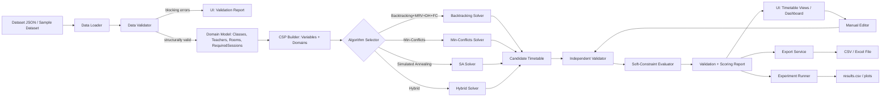
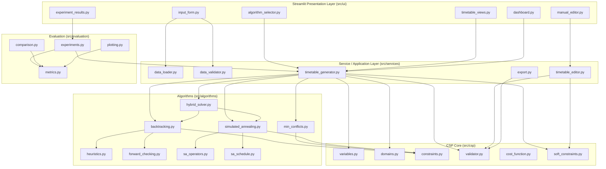

# Technical Requirements Document (TRD)
## AI-Based Timetable Scheduler

| Document Attribute | Details |
|---|---|
| Project Title | AI-Based Timetable Scheduler |
| Document Version | 1.0 |
| Document Status | Draft — Proposed for Academic Project Approval |
| Relationship to PRD | This TRD implements PRD.md v1.0. Where the PRD is silent, decisions below are explicitly marked `[ASSUMPTION]` or `[DESIGN DECISION]`. No statement here contradicts a PRD requirement; where the PRD leaves an Open Question (Section U of the PRD), this TRD proposes a resolution and references the corresponding `OQ-xxx` ID. |
| Intended Audience | Project team, developers, testers, faculty guide, evaluators |
| Primary Technology | Python 3.11+, Streamlit, pandas, openpyxl, matplotlib, pytest |
| Last Updated | 24 October 2026 |

---

# A. Document Information

## A.1 Purpose

This TRD translates the product-level requirements in `PRD.md` into an implementable technical design: architecture, module boundaries, data structures, CSP formulation, algorithm specifications, validation design, UI design, experimentation framework, test plan, and delivery roadmap.

## A.2 Scope

In scope: the design of the Streamlit prototype described in PRD Section Q.1. Out of scope: anything listed in PRD Section Q.2 (authentication, ERP integration, production deployment, distributed computing, etc.).

## A.3 Conventions

- Requirement/decision IDs: `TR-xxx` (technical requirement), `DD-xxx` (design decision), `ASM-Txxx` (technical assumption), `TC-xxx` (test case).
- `MUST` / `SHOULD` / `MAY` follow RFC-2119-style intent (not formally normative).
- PRD IDs (`FR-xxx`, `HC-xxx`, `SC-xxx`, `OBJ-xxx`, `OQ-xxx`) are referenced directly for traceability.

---

# B. Technical Overview

## B.1 Architectural Style

`DD-001`: The system is a **modular monolith** — a single Python process hosting a Streamlit UI, with scheduling logic fully decoupled from presentation code via a service layer. This is appropriate because:
- PRD ASM-006 states the prototype is single-session, not multi-user.
- No PRD requirement calls for a distributed system, a database server, or network services (PRD Q.2 excludes advanced distributed optimization).
- A monolith with strict internal module boundaries keeps NFR-007 (separation of responsibilities) satisfiable without the operational overhead of microservices, which would be unjustified complexity for an academic deliverable.

## B.2 Major Subsystems

1. **Dataset layer** — load, parse, and structurally validate input datasets (JSON).
2. **Domain model** — typed in-memory representations of all scheduling entities (Section F).
3. **CSP engine** — variables, domains, hard/soft constraint evaluators, cost function (Sections G, I).
4. **Algorithms** — Backtracking+MRV+Degree+FC, Min-Conflicts, Simulated Annealing (bonus), Hybrid (bonus) (Section H).
5. **Independent validator** — a solver-agnostic checker that is the sole authority on validity (Section J).
6. **Services layer** — orchestrates generation, editing, and export; the only layer the UI talks to.
7. **Evaluation/experiment framework** — repeated runs, metrics, comparison, plotting (Section M).
8. **Streamlit UI** — presentation only; never calls algorithms directly (Section K).
9. **Tests** — pytest suite covering every layer above (Section N).

## B.3 High-Level Data Flow



## B.4 Execution Flow (Single Generation Request)

1. UI calls `services.timetable_generator.generate(dataset, algorithm_config)`.
2. Service builds the CSP model from the validated dataset (`csp.variables`, `csp.domains`).
3. Service dispatches to the selected algorithm module, passing the CSP model and configuration (search limits, seed).
4. Algorithm returns an `AlgorithmResult` (candidate assignment or failure, plus metrics).
5. Service passes any candidate to `csp.validator` (independent of the algorithm) and to `csp.soft_constraints`.
6. Service wraps everything into a `GenerationResult` and returns it to the UI; nothing is mutated in global state outside the session object (`DD-010`, Section K.9).

---

# C. System Architecture

## C.1 Component Diagram



## C.2 Component Responsibilities

| Component | Responsibility | Must NOT do |
|---|---|---|
| `src/ui/*` | Render widgets, collect user input, call services, render results | Implement scheduling logic, constraint checks, or file parsing directly |
| `src/services/data_loader.py` | Parse JSON dataset into raw dict/DataFrame structures | Enforce business-rule validity |
| `src/services/data_validator.py` | Structural + referential validation (PRD FR-005); classify blocking vs. warning | Run CSP search |
| `src/services/timetable_generator.py` | Orchestrate CSP build → algorithm run → validation → scoring | Contain algorithm internals |
| `src/services/timetable_editor.py` | Apply a manual edit, re-run validator, manage draft/saved state | Silently save an invalid state as "current" |
| `src/services/export.py` | Serialize the canonical schedule to CSV/XLSX | Export unsaved/invalid state without explicit flag |
| `src/csp/variables.py` | Define `SessionVariable` and build the variable set from required sessions | — |
| `src/csp/domains.py` | Compute legal (time slot, room) pairs per variable | — |
| `src/csp/constraints.py` | Hard-constraint predicates, used both incrementally (search) and fully (validator) | — |
| `src/csp/validator.py` | Full, solver-independent hard-constraint check (Section J) | Trust partial/incremental state from a solver |
| `src/csp/cost_function.py` | Aggregate weighted cost (hard + soft) for local-search algorithms | Be treated as the validity authority |
| `src/csp/soft_constraints.py` | Soft-penalty calculators (SC-001…SC-005) | Affect hard validity |
| `src/algorithms/*` | Pure algorithm implementations, no I/O, no Streamlit imports | Read/write files or session state |
| `src/evaluation/*` | Run repeated experiments, compute statistics, plot | Mutate production dataset files |

## C.3 Dependency Rule

`DD-002`: Dependencies point **inward**: `ui → services → {csp, algorithms} → (stdlib/pandas)`. `algorithms` MAY depend on `csp` (constraints, cost function) but `csp` MUST NOT depend on `algorithms` or `ui`. This enables NFR-007 (algorithms testable independently of Streamlit) and OBJ-002–OBJ-005.

---

# D. Technology Stack

| Technology | Purpose | Why Suitable | Key Dependencies | Compatibility Assumption |
|---|---|---|---|---|
| Python ≥ 3.11 | Core language | Structural pattern matching, performance improvements, `dataclasses`/`typing` maturity | — | `ASM-T001`: development and evaluation machines run CPython 3.11 or 3.12 |
| Streamlit ≥ 1.30 | Interactive UI | Rapid dashboarding without a separate frontend stack; session-state model fits ASM-006 (single-session prototype) | tornado, pyarrow (via pandas interop) | Session state reset on browser refresh is acceptable per NFR-013 |
| pandas ≥ 2.0 | Tabular manipulation, CSV export, dataset summaries | De facto standard; integrates with openpyxl and Streamlit tables | numpy | — |
| openpyxl ≥ 3.1 | Excel (`.xlsx`) read/write | Pure-Python, no external binary dependency; required for FR-022 | — | Only `.xlsx` is targeted (not legacy `.xls`) |
| matplotlib ≥ 3.8 | Experiment comparison charts | Simple, dependency-light, sufficient for bar/line comparison plots (Section M) | — | Streamlit can render matplotlib figures natively via `st.pyplot` |
| pytest ≥ 7.4 | Automated testing | Fixture support, parametrization, widely known in academic settings | pytest-cov (optional, coverage reporting) | — |

`DD-003`: No database engine is introduced. Datasets and results are flat files (JSON/CSV), consistent with PRD ASM-006 and NFR-013 (limited retention). If persistence beyond a session becomes a confirmed requirement (PRD OQ-018), SQLite is the proposed minimal upgrade path — not adopted now because it is not currently justified.

`DD-004`: No dedicated CSP library (e.g., `python-constraint`, `OR-Tools`) is used for the core Backtracking/MRV/FC solver. **Rationale:** PRD OBJ-002–OBJ-004 require the project to *demonstrate* CSP concepts (variable/domain/constraint modeling, heuristic ordering, forward checking) as an academic deliverable; using an opaque third-party solver would hide the mechanism being graded. A hand-rolled, well-tested solver is therefore the correct choice for this specific assignment, even though a production system might prefer OR-Tools CP-SAT.

## D.1 Proposed `requirements.txt`

```text
# Core
streamlit>=1.30,<2.0
pandas>=2.0,<3.0
openpyxl>=3.1,<4.0
matplotlib>=3.8,<4.0

# Testing
pytest>=7.4,<9.0
pytest-cov>=4.1,<6.0        # optional: coverage reporting

# Typing / dev quality (optional, not required to run the app)
# mypy>=1.8
```

`ASM-T002`: Version ranges (not exact pins) are proposed so the team can resolve a consistent environment at setup time; exact pins SHOULD be captured via `pip freeze > requirements.lock.txt` once the development environment is finalized, for NFR-008 reproducibility.

---

# E. Repository and Module Structure

The PRD-aligned structure is adopted with minor additions (marked `[NEW]`) justified below.

```
AI-Based-Timetable-Scheduler/
├── app.py                          # Streamlit entry point (thin: page routing only)
├── requirements.txt
├── README.md
├── .gitignore
├── pytest.ini                      # [NEW] test discovery config
├── data/
│   ├── small_dataset.json
│   ├── large_dataset.json
│   ├── infeasible_sample.json      # [NEW] PRD M.2: required infeasible test case
│   └── sample_input_template.json
├── src/
│   ├── csp/
│   │   ├── __init__.py
│   │   ├── variables.py
│   │   ├── domains.py
│   │   ├── constraints.py
│   │   ├── validator.py
│   │   ├── cost_function.py
│   │   └── soft_constraints.py
│   ├── algorithms/
│   │   ├── __init__.py
│   │   ├── base.py                 # [NEW] shared AlgorithmResult / AlgorithmConfig types
│   │   ├── backtracking.py
│   │   ├── heuristics.py
│   │   ├── forward_checking.py
│   │   ├── min_conflicts.py
│   │   ├── simulated_annealing.py
│   │   ├── sa_operators.py
│   │   ├── sa_schedule.py
│   │   └── hybrid_solver.py
│   ├── services/
│   │   ├── __init__.py
│   │   ├── data_loader.py
│   │   ├── data_validator.py
│   │   ├── timetable_generator.py
│   │   ├── timetable_editor.py
│   │   └── export.py
│   ├── evaluation/
│   │   ├── __init__.py
│   │   ├── metrics.py
│   │   ├── experiments.py
│   │   ├── comparison.py
│   │   └── plotting.py
│   └── ui/
│       ├── __init__.py
│       ├── input_form.py
│       ├── algorithm_selector.py
│       ├── timetable_views.py
│       ├── dashboard.py
│       ├── experiment_results.py
│       └── manual_editor.py
├── tests/
│   ├── test_data_validator.py
│   ├── test_domains.py
│   ├── test_constraints.py
│   ├── test_backtracking.py
│   ├── test_heuristics.py
│   ├── test_forward_checking.py
│   ├── test_min_conflicts.py
│   ├── test_simulated_annealing.py
│   ├── test_hybrid_solver.py
│   ├── test_validator.py
│   ├── test_timetable_editor.py
│   ├── test_export.py
│   └── test_integration_end_to_end.py
├── experiments/
│   ├── results.csv
│   ├── run_experiments.py
│   └── figures/
├── reports/
└── docs/
```

## E.1 Module Responsibilities (Summary Table)

| Module | Responsibility |
|---|---|
| `app.py` | Instantiates Streamlit pages/navigation; holds no business logic |
| `src/algorithms/base.py` `[NEW]` | `AlgorithmConfig`, `AlgorithmResult`, `TerminationStatus` shared dataclasses/enums so every algorithm honors the Common Algorithm Output Contract (PRD K.5) |
| `src/csp/variables.py` | `SessionVariable` construction from `RequiredSession` list |
| `src/csp/domains.py` | Legal `(day, period, room)` enumeration per variable, pre-filtered by static constraints (room type/capacity) |
| `src/csp/constraints.py` | Pairwise/global hard-constraint predicates, reused by search (incremental) and validator (full) |
| `src/csp/validator.py` | `validate(timetable, dataset) -> ValidationReport` — the sole validity authority (Section J) |
| `src/csp/cost_function.py` | `total_cost(timetable) = WEIGHT_HARD * hard_violations + soft_penalty` for local-search guidance only |
| `src/csp/soft_constraints.py` | SC-001..SC-005 penalty functions and weight configuration |
| `src/services/data_loader.py` | JSON → `Dataset` dataclass tree |
| `src/services/data_validator.py` | Structural/referential checks (FR-005), returns `DatasetValidationReport` |
| `src/services/timetable_generator.py` | Facade: `generate(dataset, algo_name, config) -> GenerationResult` |
| `src/services/timetable_editor.py` | `propose_edit`, `apply_edit`, `discard_edit`; always re-validates (FR-016, FR-021) |
| `src/services/export.py` | `to_csv(timetable)`, `to_xlsx(timetable)` |
| `src/evaluation/experiments.py` | Runs N repeated trials per (dataset, algorithm, config) tuple |
| `src/evaluation/metrics.py` | Aggregation: mean/median runtime, penalty stats, success rate |
| `src/evaluation/comparison.py` | Cross-algorithm comparison tables |
| `src/evaluation/plotting.py` | matplotlib figure builders consumed by `dashboard.py`/`experiment_results.py` |

`DD-005`: `infeasible_sample.json` and `pytest.ini` are added because PRD M.2/M.6 explicitly require at least one infeasible dataset and the test plan (Section N) requires deterministic test discovery configuration.

---

# F. Domain Model and Data Structures

## F.1 Core Entities

### F.1.1 `Class` (Group)
| Field | Type | Notes |
|---|---|---|
| `class_id` | str (unique) | e.g. `"C1"` |
| `name` | str | Display name |
| `size` | int | Number of students (drives HC-004) |
| `calendar_id` | str | `[ASM]` refers to a shared calendar unless OQ-003 confirms per-class calendars; default: all classes share `"default"` |

### F.1.2 `Teacher`
| Field | Type | Notes |
|---|---|---|
| `teacher_id` | str (unique) | |
| `name` | str | |
| `subjects_qualified` | list[str] | subject IDs this teacher may teach |
| `availability` | list[`SlotRef`] or `unavailable_slots: list[SlotRef]` | `[DESIGN DECISION]` store **unavailable** slots (sparse) rather than available ones, since most teachers are available most periods — see `DD-006` |
| `max_daily_periods` | int \| null | HC-008 |
| `max_weekly_periods` | int \| null | HC-008 |
| `preferred_slots` | list[`SlotRef`] | SC-004, optional |
| `undesired_slots` | list[`SlotRef`] | SC-004, optional |

`DD-006`: Availability is stored as an **unavailable-slot exclusion list** rather than an enumerated available list. Rationale: typical academic datasets have few blocked periods per teacher; an exclusion list is smaller, easier to author by hand in JSON, and still trivially converted to an available-set at load time (`available = all_slots - unavailable_slots`).

### F.1.3 `Room`
| Field | Type | Notes |
|---|---|---|
| `room_id` | str (unique) | |
| `capacity` | int | HC-004 |
| `room_type` | str (enum: `"lecture"`, `"lab"`, `"seminar"`, ...) | HC-005 |
| `unavailable_slots` | list[`SlotRef`] | optional, mirrors teacher availability model |

### F.1.4 `Subject`
| Field | Type | Notes |
|---|---|---|
| `subject_id` | str (unique) | |
| `name` | str | |
| `requires_room_type` | str \| null | HC-005 |
| `is_lab` | bool | Drives HC-010/SC-005 applicability |

### F.1.5 `SlotRef` (Time Slot)
| Field | Type | Notes |
|---|---|---|
| `day` | int (0–4, Mon–Fri) | ASM-001: 5-day week default |
| `period` | int (1–N) | N configurable per dataset (`periods_per_day`) |

`DD-007`: Time slots are **discrete** (PRD ASM-002); a `SlotRef(day, period)` tuple is the atomic unit of time. Adjacency for HC-010/SC-005 is defined as `period2 == period1 + 1` on the same `day`, using the dataset's declared period ordering (no wraparound across days).

### F.1.6 `RequiredSession` (requirement, NOT an assignment)
Represents a single required occurrence of a class-subject teaching period. This is distinct from a `ScheduledSession` — see `DD-008`.

| Field | Type | Notes |
|---|---|---|
| `requirement_id` | str (unique) | e.g. `"REQ-C1-MATH-03"` — the 3rd of 4 weekly Math periods for C1 |
| `class_id` | str (FK) | |
| `subject_id` | str (FK) | |
| `teacher_id` | str (FK) | Pre-assigned per PRD OQ-006 default |
| `duration_periods` | int | Usually 1; >1 for sessions requiring a contiguous block |
| `consecutive_required` | bool | HC-010 applicability (OQ-005) |
| `occurrence_index` | int | 1..N, which weekly occurrence this is |
| `occurrence_total` | int | N, total weekly occurrences for this class-subject pair |

`DD-008` **(critical modeling decision, resolves PRD OQ-002):** Each weekly occurrence of a class-subject requirement is **expanded at dataset-load time into its own `RequiredSession`** (one CSP variable each), rather than representing "4 periods/week" as a single variable with a duration attribute spread across multiple slots. Rationale:
- Produces a uniform CSP variable granularity (`DD-011`), which simplifies MRV/Degree/FC implementation (OBJ-003, OBJ-004).
- HC-007 ("exactly N scheduled periods") becomes a simple cardinality check: `count(ScheduledSession where requirement in {REQ-C1-MATH-01..04}) == 4`.
- A `duration_periods > 1` session (e.g., a 2-period lab block) is still one `RequiredSession`, but its *domain* only contains starting slots where `duration_periods` consecutive periods are free (handled in `domains.py`); this keeps block sessions and repeated single-period sessions in the same model without special-casing search.

### F.1.7 `ScheduledSession` (an assignment)
| Field | Type | Notes |
|---|---|---|
| `requirement_id` | str (FK → `RequiredSession`) | |
| `day` | int | |
| `start_period` | int | |
| `duration_periods` | int | copied from requirement for convenience |
| `room_id` | str (FK) | |
| `teacher_id` | str (FK) | copied from requirement |
| `class_id` | str (FK) | copied from requirement |
| `subject_id` | str (FK) | copied from requirement |

### F.1.8 `Timetable`
| Field | Type | Notes |
|---|---|---|
| `timetable_id` | str | UUID or incrementing ID per generation/edit |
| `dataset_id` | str | links to the dataset version used |
| `scheduled_sessions` | list[`ScheduledSession`] | |
| `unscheduled_requirement_ids` | list[str] | required sessions not placed (incomplete case) |
| `generated_by` | str | algorithm name |
| `generated_at` | datetime | |
| `status` | enum | `"Valid"`, `"Invalid"`, `"Incomplete"`, `"NoCandidate"`, `"NotEvaluated"` (PRD L.7) |

### F.1.9 `Constraint` (engine-internal representation)
| Field | Type | Notes |
|---|---|---|
| `constraint_id` | str | e.g. `"HC-001"` |
| `kind` | enum | `"hard"` / `"soft"` |
| `scope` | enum | `"pairwise"`, `"global"` |
| `evaluator` | callable | see Section I |
| `weight` | float | soft only; `SC-xxx` weight `w_i` (PRD I.6) |

### F.1.10 `AlgorithmConfig`
| Field | Type | Notes |
|---|---|---|
| `algorithm` | enum | `"backtracking"`, `"min_conflicts"`, `"simulated_annealing"`, `"hybrid"` |
| `max_search_nodes` | int \| null | Backtracking limit (NFR-002) |
| `max_iterations` | int \| null | Min-Conflicts/SA limit |
| `random_seed` | int \| null | OQ-012, NFR-015 |
| `initial_temperature` | float | SA only |
| `cooling_rate` | float | SA only |
| `min_temperature` | float | SA only |
| `soft_weights` | dict[str, float] | overrides default SC weights |

### F.1.11 `ExperimentResult`
| Field | Type | Notes |
|---|---|---|
| `run_id` | str | |
| `dataset_id` | str | |
| `algorithm` | str | |
| `config` | `AlgorithmConfig` (serialized) | |
| `runtime_seconds` | float | |
| `hard_violations` | int | |
| `soft_penalty` | float | |
| `status` | enum | PRD L.7 |
| `termination_status` | enum | `"success"`, `"exhausted"`, `"search_limit"`, `"timeout"`, `"internal_failure"` |
| `search_nodes_or_iterations` | int \| null | |
| `timestamp` | datetime | |

## F.2 Representative JSON Schemas

### F.2.1 Dataset Configuration (top level)

```json
{
  "dataset_id": "small_v1",
  "description": "Small feasible demonstration dataset",
  "days": 5,
  "periods_per_day": 6,
  "lunch_period": 4,
  "classes": [ "...see F.2.3..." ],
  "teachers": [ "...see F.2.2..." ],
  "subjects": [ "...see F.2.4..." ],
  "rooms": [ "...see F.2.5..." ],
  "requirements": [ "...see F.2.7..." ]
}
```

### F.2.2 Teachers

```json
{
  "teacher_id": "T1",
  "name": "Dr. A. Rao",
  "subjects_qualified": ["MATH", "STATS"],
  "unavailable_slots": [ { "day": 0, "period": 1 } ],
  "max_daily_periods": 4,
  "max_weekly_periods": 18,
  "preferred_slots": [ { "day": 1, "period": 2 } ],
  "undesired_slots": [ { "day": 4, "period": 6 } ]
}
```

### F.2.3 Classes

```json
{
  "class_id": "C1",
  "name": "Grade 10 - A",
  "size": 32,
  "calendar_id": "default"
}
```

### F.2.4 Subjects

```json
{
  "subject_id": "MATH",
  "name": "Mathematics",
  "requires_room_type": null,
  "is_lab": false
}
```

### F.2.5 Rooms

```json
{
  "room_id": "R1",
  "capacity": 40,
  "room_type": "lecture",
  "unavailable_slots": []
}
```

```json
{
  "room_id": "LAB1",
  "capacity": 24,
  "room_type": "computer_lab",
  "unavailable_slots": [ { "day": 2, "period": 6 } ]
}
```

### F.2.6 Teacher Availability (embedded above; standalone example)

```json
{
  "teacher_id": "T2",
  "unavailable_slots": [
    { "day": 0, "period": 1 },
    { "day": 0, "period": 2 },
    { "day": 3, "period": 6 }
  ]
}
```

### F.2.7 Required Weekly Subject Hours / Requirement Entry

```json
{
  "class_id": "C1",
  "subject_id": "MATH",
  "teacher_id": "T1",
  "weekly_periods": 4,
  "duration_periods": 1,
  "consecutive_required": false
}
```

This "weekly requirement" entry is **expanded at load time** (`DD-008`) into 4 `RequiredSession` objects: `REQ-C1-MATH-01..04`, each `occurrence_total=4`.

### F.2.8 Laboratory Requirement (consecutive, mandatory)

```json
{
  "class_id": "C2",
  "subject_id": "CHEM_LAB",
  "teacher_id": "T5",
  "weekly_periods": 2,
  "duration_periods": 2,
  "consecutive_required": true
}
```

Expands into a **single** `RequiredSession` with `duration_periods=2` (one block), not two separate 1-period sessions — because the whole point is contiguity (HC-010).

### F.2.9 Timetable Assignment (Scheduled Session)

```json
{
  "requirement_id": "REQ-C1-MATH-03",
  "class_id": "C1",
  "subject_id": "MATH",
  "teacher_id": "T1",
  "day": 1,
  "start_period": 2,
  "duration_periods": 1,
  "room_id": "R1"
}
```

### F.2.10 Algorithm Configuration

```json
{
  "algorithm": "backtracking",
  "max_search_nodes": 200000,
  "random_seed": 42,
  "soft_weights": { "SC-001": 1.0, "SC-002": 0.5, "SC-003": 1.0, "SC-004": 0.75, "SC-005": 1.0 }
}
```

### F.2.11 Exported Timetable (CSV row schema)

```json
{
  "day": "Monday",
  "period": 2,
  "class": "Grade 10 - A",
  "subject": "Mathematics",
  "teacher": "Dr. A. Rao",
  "room": "R1"
}
```

---

# G. CSP Formulation

## G.1 Variables

`DD-009` (resolves PRD K.1 "Product Behavior" item 1): **One CSP variable per `RequiredSession`** (per `DD-008`). For a dataset with `Σ weekly_periods` total required occurrences (counting a lab block as one occurrence), the variable set is:

```
X = { X_r : r ∈ RequiredSessions }
```

## G.2 Domains

For variable `X_r` (class `c`, subject `s`, teacher `t`, duration `d`):

```
Domain(X_r) = { (day, start_period, room) :
    room.room_type compatible with s.requires_room_type        [HC-005, static]
    AND room.capacity >= c.size                                  [HC-004, static]
    AND all periods [start_period .. start_period+d-1] exist within day  [bounds]
    AND start_period block does not overlap room.unavailable_slots
    AND start_period block does not overlap t.unavailable_slots  [HC-006, static]
    AND start_period block does not overlap mandatory lunch slot for c/t  [HC-009, static]
}
```

Domains are computed **once at CSP-build time** using only *static* (single-variable) restrictions. Restrictions that depend on *other* variables' assignments (teacher/class/room non-overlap, workload) are enforced during search via constraint checking and Forward Checking pruning, not baked into the initial domain.

## G.3 Assignment

A complete assignment `A` maps every `X_r ∈ X` to a value in `Domain(X_r)`. A **partial assignment** is a prefix of this mapping during search.

## G.4 Hard Constraints (search-time + validator-time)

| ID | Constraint | Scope | Checked incrementally during search? |
|---|---|---|---|
| HC-001 | Teacher non-overlap | pairwise (same teacher) | Yes |
| HC-002 | Class non-overlap | pairwise (same class) | Yes |
| HC-003 | Room non-overlap | pairwise (same room) | Yes |
| HC-004 | Room capacity | unary (baked into domain) | Yes (domain-level) |
| HC-005 | Room type compatibility | unary (baked into domain) | Yes (domain-level) |
| HC-006 | Teacher availability | unary (baked into domain) | Yes (domain-level) |
| HC-007 | Weekly subject-hour count | global (per class-subject group) | Partially — see `DD-012` |
| HC-008 | Teacher max workload | global (per teacher, per day/week) | Yes, incrementally accumulated |
| HC-009 | Mandatory lunch break | unary (baked into domain) | Yes (domain-level) |
| HC-010 | Consecutive lab periods | unary for block sessions (domain only contains valid contiguous starts) | Yes (domain-level) |

`DD-012`: HC-007 is **structurally guaranteed** by `DD-008` (one variable per required occurrence means "all variables assigned" ⇒ count satisfied) **except** when a variable is left unassigned due to search failure — in which case the timetable is `Incomplete`, which the validator treats as invalid-for-completeness (PRD I.7). The validator re-derives and re-checks the count independently rather than trusting this structural guarantee (`DD-013`, Section J), because a bug in variable generation must not silently produce an undetected HC-007 violation.

## G.5 Soft Constraints

| ID | Constraint | Penalty basis |
|---|---|---|
| SC-001 | Minimize class gaps | count of empty periods strictly between first and last scheduled period of a class on a day |
| SC-002 | Distribute subjects across days | penalty increases super-linearly with repeated same-subject-same-day occurrences for a class in a week |
| SC-003 | Limit consecutive teaching periods | penalty for each run of consecutive periods for a teacher exceeding `max_preferred_consecutive` (configurable, default `ASM-T003 = 3`) |
| SC-004 | Teacher time preferences | penalty if assigned slot ∈ `undesired_slots`; 0 if ∈ `preferred_slots` or neutral |
| SC-005 | Lab continuity (preference only) | penalty if a `consecutive_required=false` but `is_lab=true` subject's multiple weekly occurrences are not scheduled back-to-back |

Soft constraints are **never** checked during Backtracking's hard-feasibility pruning; they are evaluated only (a) to guide Min-Conflicts/SA value selection, and (b) by the final soft-constraint evaluator for reporting (PRD FR-015).

## G.6 Objective / Cost Function

`DD-014` (addresses the prompt's proposed weighting):

```
total_cost(timetable) = WEIGHT_HARD * hard_violation_count(timetable)
                       + Σ_i  w_i * P_i(timetable)        # soft penalties, PRD I.6
```

`ASM-T004`: `WEIGHT_HARD = 1000`, chosen to be at least an order of magnitude larger than any plausible cumulative soft penalty on the proposed small/large datasets, so that **no amount of soft-constraint improvement can make a cost-function comparison prefer a hard-violating candidate over a feasible one** during local search. This value is a tunable constant, not a proof — see the caveat below.

**This weighted cost is used only internally by Min-Conflicts/SA/Hybrid to guide search.** `DD-015` (explicitly required by the PRD, Section I.6 and the prompt): **the weighted cost is never the authority on validity.** Only `src/csp/validator.py` (Section J), running the full, unweighted hard-constraint check, determines whether `status = Valid`. This separation exists precisely because a large but finite `WEIGHT_HARD` cannot *guarantee* that a search algorithm's local minimum has zero hard violations — the validator closes that gap by independently re-verifying from scratch.

`DD-016`: Wherever feasible, search operators (Min-Conflicts' value selection, SA's neighbor generator in the Hybrid stage) are designed to be **hard-constraint-preserving by construction** (i.e., only propose moves that keep HC-001..HC-010 satisfied) rather than relying solely on the weighted penalty to discourage violations — see Sections H.5 and H.7.

## G.7 Feasibility vs. Optimization

- **Feasibility** = does there exist a complete assignment with `hard_violation_count == 0` and no `RequiredSession` unassigned? This is a decision problem; Backtracking (exhaustive) can, in principle, prove infeasibility.
- **Optimization** = among feasible assignments, minimize `Σ w_i P_i`. This is only meaningful once feasibility is established; PRD OQ-014 proposes "feasibility first, then soft penalty" as the ordering used to pick a "best" result, which this TRD adopts (`DD-017`).

---

# H. Algorithm Design

All algorithms implement a common interface defined in `src/algorithms/base.py`:

```python
@dataclass
class AlgorithmResult:
    status: Literal["Valid", "Invalid", "Incomplete", "NoCandidate"]
    termination: Literal["success", "exhausted", "search_limit", "timeout", "internal_failure"]
    timetable: Optional[Timetable]
    runtime_seconds: float
    search_nodes_or_iterations: int
    config_used: AlgorithmConfig
```

`DD-018`: No algorithm module marks its own `status` as `"Valid"`; algorithms report only `termination` and return a *candidate*. The generator service (`timetable_generator.py`) always re-derives `status` by invoking `csp.validator` and `csp.soft_constraints` — this is how `DD-015` is enforced architecturally, not just by convention.

## H.1 Backtracking CSP

**Inputs:** CSP model (`X`, `Domain`), `AlgorithmConfig.max_search_nodes`.
**Output:** `AlgorithmResult`.

**Variable selection:** MRV, tie-broken by Degree Heuristic (Section H.2/H.3).
**Value (candidate) ordering:** `ASM-T005` — domain values ordered by ascending incremental soft-penalty contribution ("least constraining value w.r.t. soft preferences") as a tie-breaker only; hard-feasibility ordering is not required since any legal domain value is hard-feasible by construction (domain already excludes unary-infeasible values) and pairwise feasibility is checked at assignment time regardless of order.
**Assignment & rollback:** Standard recursive backtracking with an explicit assignment stack; Forward Checking domain-reduction snapshots are pushed/popped alongside each assignment (Section H.4).
**Termination:**
- Success: all variables assigned, no hard violation detected during search.
- Exhausted: search space fully explored without a complete assignment ⇒ candidate proof of infeasibility *for the modeled problem* (PRD K.1, "Comparison").
- Search-limit: `nodes_expanded >= max_search_nodes` ⇒ `termination="search_limit"`, **not** treated as infeasibility proof (NFR-002, ASM-007).

**Pseudocode:**

```
function BACKTRACK(assignment, domains, config, stats):
    stats.nodes += 1
    if stats.nodes > config.max_search_nodes:
        return FAILURE("search_limit")
    if assignment is complete:
        return assignment
    var = SELECT_UNASSIGNED_VARIABLE(assignment, domains)   # MRV + Degree
    for value in ORDER_DOMAIN_VALUES(var, domains):
        if IS_CONSISTENT(var, value, assignment):            # HC-001/002/003/008 pairwise+accumulated
            assignment[var] = value
            removed = FORWARD_CHECK(var, value, domains)     # prune neighbor domains
            if NO_DOMAIN_WIPEOUT(domains):
                result = BACKTRACK(assignment, domains, config, stats)
                if result is not FAILURE:
                    return result
            RESTORE(domains, removed)
            del assignment[var]
    return FAILURE("exhausted_this_branch")
```

**Failure reporting:** distinguishes `"search_limit"` from a top-level `"exhausted"` (search tree fully returned FAILURE at the root).

## H.2 Minimum Remaining Values (MRV)

For each unassigned variable `v`, compute `legal_count(v) = |{value ∈ Domain(v) : consistent with current partial assignment}|` (i.e., current *pruned* domain size after Forward Checking, not the static initial domain). Select `argmin legal_count(v)`. Ties are passed to the Degree Heuristic.

`TC-H2-1`: A fixture with two unassigned variables where FC has pruned one to 2 legal values and the other to 5 MUST select the 2-value variable next.

## H.3 Degree Heuristic

Among MRV-tied variables, compute `degree(v) = number of other unassigned variables that share a hard constraint with v` (same teacher, same class, or same room-type pool with overlapping candidate slots). Select `argmax degree(v)`. If still tied, break ties deterministically by `requirement_id` lexicographic order (`ASM-T006`, ensures reproducibility for a fixed dataset — supports NFR-003).

`TC-H3-1`: A fixture with two MRV-tied variables, one sharing a teacher with 3 other unassigned variables and the other with 1, MUST select the degree-3 variable next.

## H.4 Forward Checking

After tentatively assigning `X_r = (day, period, room)`:
1. For every unassigned variable `X_q` that could conflict with this assignment (same teacher, same class, or same room and overlapping time), remove from `Domain(X_q)` any value that would violate HC-001/002/003/008 given the new assignment.
2. Record removed `(variable, value)` pairs on a per-assignment-level undo stack.
3. If any affected `Domain(X_q)` becomes empty → **domain wipeout** → immediately signal failure for this branch (no deeper recursion).
4. On backtrack, pop the undo stack and restore exactly the removed values.

`TC-H4-1`: Construct a 3-variable fixture where assigning the first variable empties the domain of a second; FC MUST detect the wipeout before recursing into the third variable (verified by node-count assertion — the recursive call is never made).

## H.5 Min-Conflicts

**Inputs:** CSP model, `AlgorithmConfig.max_iterations`, `random_seed`.
**Output:** `AlgorithmResult`.

**Initial assignment (`DD-019`, resolves OQ-009):** Assign every variable a domain value chosen uniformly at random (seeded), **ignoring pairwise hard constraints** (an intentionally infeasible starting point, as is standard for Min-Conflicts — PRD OQ-009's "feasibility-repair stage" option is adopted). If a variable's domain is empty even unary-wise (should not happen given domain construction), that variable is left unassigned and reported in `unscheduled_requirement_ids`.

**Conflict calculation:** `conflicts(X_r) = count of hard-constraint violations (HC-001/002/003/008) involving X_r's current value against all other current assignments.` Soft penalties are tracked **separately** and never summed into "conflicts" (`DD-015` applied at this level too).

**Pseudocode:**

```
function MIN_CONFLICTS(assignment0, domains, config, stats):
    assignment = assignment0
    for i in 1..config.max_iterations:
        stats.iterations = i
        conflicted = [v for v in variables if conflicts(v, assignment) > 0]
        if conflicted is empty:
            return SUCCESS(assignment)                      # zero hard conflicts
        var = random_choice(conflicted, rng)                 # seeded RNG
        value = argmin_{val in Domain(var)} conflicts_if_set(var, val, assignment)
                # ties broken by lowest soft-penalty contribution, then by rng
        assignment[var] = value
    return FAILURE("search_limit", best_assignment_seen)
```

**Plateau escape:** `ASM-T007` — when the selected value does not strictly reduce total hard conflicts (a plateau move), allow the move anyway up to `plateau_patience` consecutive non-improving steps (default 50); if exceeded, perform a **random restart of a random subset (≈10%) of variables** rather than the full assignment, to retain partial progress (`DD-020`, standard Min-Conflicts enhancement, explicitly labeled as a proposed default pending confirmation).

**Termination/failure reporting:** Success only on zero hard conflicts. Reaching `max_iterations` without zero conflicts ⇒ `termination="search_limit"`; the returned candidate is still passed to the independent validator and will be reported `Invalid` (never silently upgraded).

## H.6 Simulated Annealing *(bonus, PRD OBJ-016)*

**State representation:** A complete (possibly hard-infeasible) assignment, identical representation to Min-Conflicts' state.

**Initial state (`DD-021`):** `ASM-T008` — prefer seeding SA from a Min-Conflicts or Backtracking-feasible result when available (see Hybrid, Section H.7); standalone SA (if run independently per PRD K.3) uses the same random initial assignment as Min-Conflicts.

**Neighbor generation operators (`sa_operators.py`):**
- `move_session`: reassign one randomly chosen `RequiredSession`'s variable to a new domain value.
- `swap_sessions`: swap the (day, period, room) of two same-duration sessions.

**Cost function:** `total_cost` from Section G.6 (`WEIGHT_HARD=1000` by default), so SA is nominally hard-constraint-aware, but see `DD-016` — the Hybrid stage additionally **restricts the neighbor generator to only propose moves that keep hard violations at zero**, since standalone cost-based discouragement is not a guarantee.

**Temperature/cooling (`sa_schedule.py`):**
- `T_0` = `ASM-T009`: initial temperature set to roughly the standard deviation of `total_cost` across ~30 random neighbor samples of the initial state (adaptive default), overridable via `AlgorithmConfig`.
- Cooling schedule: geometric, `T_{k+1} = cooling_rate * T_k`, default `cooling_rate = 0.95` (`ASM-T010`).
- Minimum temperature / iteration cap as stopping condition.

**Acceptance probability:** standard Metropolis criterion:

```
Δ = cost(neighbor) - cost(current)
if Δ <= 0: accept
else: accept with probability exp(-Δ / T)
```

**Pseudocode:**

```
function SIMULATED_ANNEALING(initial_state, config, rng):
    current = initial_state
    best = current
    T = config.initial_temperature
    for i in 1..config.max_iterations:
        if T < config.min_temperature: break
        neighbor = GENERATE_NEIGHBOR(current, rng)
        delta = cost(neighbor) - cost(current)
        if delta <= 0 or rng.random() < exp(-delta / T):
            current = neighbor
        if cost(current) < cost(best):
            best = current
        T = T * config.cooling_rate
    return best, current, stats
```

**Reporting:** both `best` (lowest cost seen) and `current` (final state) are retained internally; `AlgorithmResult.timetable` uses `best` (`DD-022` — reporting the best-ever state is more useful for timetable quality than the possibly-worse final state, a standard SA practice).

**Infeasible states:** permitted during the walk (that is the point of exploring beyond local optima); only `best`'s hard-feasibility is what matters for the final report, and it is still independently re-validated — SA offers **no feasibility guarantee**, which is explicitly disclosed rather than assumed.

**Trade-offs (for the project report, PRD K.3 "Limitations"):** SA can escape Min-Conflicts' local optima and explore broader soft-quality improvements, but has no completeness guarantee, is sensitive to cooling schedule and neighborhood design, and may spend iterations exploring infeasible territory unless hard-preserving operators are used (as in the Hybrid).

## H.7 Hybrid CSP + Simulated Annealing *(bonus, PRD OBJ-017)*

**Workflow (`DD-023`):**

```
function HYBRID(dataset, config):
    csp_result = BACKTRACK(... config.csp_stage ...)        # or MIN_CONFLICTS, per OQ-009
    if csp_result.status != feasible candidate:
        return AlgorithmResult(status="NoCandidate",
                                termination="internal_failure",  # ERR-022
                                timetable=None)
    initial_cost = soft_penalty(csp_result.timetable)
    sa_result = SIMULATED_ANNEALING(
        initial_state = csp_result.timetable,
        neighbor_fn = HARD_PRESERVING_NEIGHBOR,   # only proposes moves kept hard-feasible
        config = config.sa_stage
    )
    final_cost = soft_penalty(sa_result.best)
    return AlgorithmResult(timetable=sa_result.best, ...,
                            extra={"initial_cost": initial_cost, "final_cost": final_cost})
```

`HARD_PRESERVING_NEIGHBOR` generates a candidate move, applies it to a copy, and **rejects** (resamples) it if `hard_violation_count` would increase above zero — i.e., the neighbor generator only ever walks within the feasible region once a feasible starting point exists. This directly implements `DD-016` and PRD K.4's requirement that "optimization preserves hard-constraint validity."

**Fallback when CSP finds no feasible initial timetable:** `DD-024` (resolves OQ-011) — **no automatic fallback initializer is implemented in the MVP.** The Hybrid reports `status="NoCandidate"`, `termination="internal_failure"`, matching `ERR-022`. A documented *optional* extension (not required for MVP) would allow falling back to a Min-Conflicts-derived near-feasible seed, but this is explicitly out of scope unless OQ-011 is resolved in favor of requiring it.

**Final validation:** identical to every other algorithm — the Hybrid's output is just another candidate passed to `csp.validator` (`DD-018`).

---

# I. Constraint Engine and Cost Function

## I.1 Constraint Interface

```python
@dataclass
class Violation:
    constraint_id: str          # e.g. "HC-001"
    kind: Literal["hard", "soft"]
    message: str
    session_ids: list[str]      # affected RequiredSession / ScheduledSession ids
    resource_ids: dict[str, str]  # e.g. {"teacher_id": "T1", "day": "1", "period": "2"}

class Constraint(Protocol):
    constraint_id: str
    kind: Literal["hard", "soft"]
    def evaluate(self, timetable: Timetable, dataset: Dataset) -> list[Violation]: ...
```

Each `HC-xxx`/`SC-xxx` is implemented as one object conforming to this protocol in `constraints.py` (hard) or `soft_constraints.py` (soft). This uniform interface is what both the incremental search checks (Section H) and the full validator (Section J) are built from — **the same predicate logic is reused**, reducing `RISK-006` (solver/validator divergence) by construction (`DD-025`).

## I.2 Hard-Violation Reporting

`validate_hard(timetable, dataset) -> list[Violation]` runs every registered hard `Constraint.evaluate(...)` and concatenates results. `len(violations) == 0` is necessary (with completeness) for `status = Valid`.

`DD-026` — **violation counting policy** (resolves the PRD's open counting-policy note in L.1): a pairwise conflict between exactly two overlapping sessions is counted as **one** violation per offending pair (not two), to avoid double-counting; a three-way overlap (e.g., three sessions sharing a slot+teacher, a malformed edge case) is counted as `C(3,2)=3` pairwise violations, each separately reported with its two `session_ids`, so every conflicting pair is individually diagnosable.

## I.3 Soft-Penalty Aggregation

```
soft_penalty(timetable) = Σ_i  w_i * P_i(timetable)
```

`penalty_breakdown(timetable) -> dict[str, float]` returns each `SC-xxx`'s unweighted `P_i` and weighted contribution, satisfying FR-015's "individual penalty components available for inspection."

## I.4 Incremental vs. Full Evaluation

| Evaluation mode | Used by | What it checks |
|---|---|---|
| Incremental (per-assignment) | Backtracking (`IS_CONSISTENT`), Forward Checking, Min-Conflicts (`conflicts()`) | Only constraints affected by the newly changed variable(s); an optimization, not a different rule set |
| Full | `csp/validator.py`, called after any algorithm returns, after every manual edit, and before export | All constraints, over the complete timetable, re-derived from scratch — ignores any solver-internal bookkeeping |

## I.5 Worked Example

Given two `ScheduledSession`s:
```
S1: teacher=T1, class=C1, day=1, period=2, room=R1
S2: teacher=T1, class=C2, day=1, period=2, room=R2
```
`HC-001` (teacher non-overlap) evaluator detects `T1` has two sessions at `(day=1, period=2)` → emits:
```json
{"constraint_id": "HC-001", "kind": "hard",
 "message": "Teacher T1 is assigned two overlapping sessions on day 1, period 2.",
 "session_ids": ["REQ-C1-X-..", "REQ-C2-Y-.."],
 "resource_ids": {"teacher_id": "T1", "day": "1", "period": "2"}}
```
This single violation contributes `1000 * 1 = 1000` to `total_cost` (Section G.6) and, independently, `hard_violation_count = 1` in the validator's report — demonstrating the two numbers are related but **serve different purposes** (cost guides search; the count determines validity).

---

# J. Independent Validation

## J.1 Design Principle

`csp/validator.py` is constructed to take **only** `(Timetable, Dataset)` as input — it never receives or trusts any solver-internal state (assignment stack, pruned domains, iteration counters). This directly satisfies PRD Section J's instruction and `RISK-006` mitigation.

## J.2 Checks Performed

```
function VALIDATE(timetable, dataset) -> ValidationReport:
    violations = []
    violations += check_required_sessions_complete(timetable, dataset)   # HC-007 (completeness)
    violations += check_teacher_nonoverlap(timetable)                     # HC-001
    violations += check_class_nonoverlap(timetable)                      # HC-002
    violations += check_room_nonoverlap(timetable)                       # HC-003
    violations += check_room_capacity(timetable, dataset)                 # HC-004
    violations += check_room_type(timetable, dataset)                     # HC-005
    violations += check_teacher_availability(timetable, dataset)          # HC-006
    violations += check_weekly_session_counts(timetable, dataset)         # HC-007 (count)
    violations += check_teacher_workload(timetable, dataset)              # HC-008
    violations += check_lunch_breaks(timetable, dataset)                  # HC-009
    violations += check_lab_contiguity(timetable, dataset)                # HC-010
    status = "Incomplete" if any unscheduled required sessions
             else ("Valid" if violations is empty else "Invalid")
    return ValidationReport(status, len(violations), categorize(violations), violations)
```

## J.3 `ValidationReport` Structure

```json
{
  "status": "Invalid",
  "total_hard_violations": 2,
  "violation_categories": { "HC-001": 1, "HC-004": 1 },
  "violations": [
    { "constraint_id": "HC-001", "kind": "hard", "message": "...",
      "session_ids": ["REQ-C1-MATH-02", "REQ-C3-PHY-01"],
      "resource_ids": {"teacher_id": "T1", "day": "1", "period": "2"} },
    { "constraint_id": "HC-004", "kind": "hard", "message": "...",
      "session_ids": ["REQ-C5-BIO-01"],
      "resource_ids": {"room_id": "R2"} }
  ]
}
```

## J.4 Invocation Points

Validation runs at exactly three points (`DD-027`), never skipped:
1. **After generation** — every `AlgorithmResult.timetable` (Section H.1's `DD-018`).
2. **After each accepted manual edit** — Section L (FR-016, FR-021).
3. **Before export** — Section L.5 / FR-022, to disclose current validity to the user even if export of invalid drafts is later permitted (OQ-017).

`NFR-003` (consistent validation) is satisfied because `VALIDATE` is a pure function of `(timetable, dataset)` with no hidden mutable state.

---

# K. Streamlit Application Design

## K.1 Entry Point and Navigation

`app.py` sets page config and renders a sidebar nav (`st.sidebar.radio` or `st.tabs`) mapping to the workflow in PRD J.1: **Dataset → Validation → Algorithm → Generation → Evaluation → Review/Edit → Export**, plus an **Experiments** tab. Each page is a thin function in `src/ui/*` that reads/writes `st.session_state` and calls `src/services/*` — never `src/csp/*` or `src/algorithms/*` directly (`DD-002`).

## K.2 Page-by-Page Responsibilities

| Page (`src/ui/...`) | Calls | Renders |
|---|---|---|
| `input_form.py` | `data_loader`, `data_validator` | Sample/upload selector, entity summary, validation messages (blocking vs. warning, PRD J.3) |
| `algorithm_selector.py` | (config only, no execution) | Algorithm list, implementation status, config widgets (search limit, seed), "Generate" button |
| `timetable_generator` invocation lives in `algorithm_selector.py`'s button handler → `services.timetable_generator.generate(...)` | | Progress spinner (`st.spinner`), completion/failure banner |
| `timetable_views.py` | `services.timetable_generator` (reads cached result) | Class-wise / teacher-wise / room-wise tables (`st.dataframe`), filters |
| `dashboard.py` | validator + soft evaluator results (already computed) | Validity status, hard-violation breakdown, soft-penalty breakdown |
| `manual_editor.py` | `services.timetable_editor` | Session picker, new slot/room proposer, immediate re-validation feedback |
| `experiment_results.py` | `src/evaluation/*` | Comparison tables/charts (`st.pyplot`) |
| (export control embedded in `timetable_views.py` or a dedicated `export_panel`) | `services.export` | Download buttons (`st.download_button`) for CSV/XLSX |

## K.3 Session State Management

`DD-028` — canonical state keys:

```python
st.session_state = {
    "dataset": Dataset | None,
    "dataset_validation": DatasetValidationReport | None,
    "algorithm_config": AlgorithmConfig,
    "generation_result": GenerationResult | None,   # last Generate click
    "current_timetable": Timetable | None,           # canonical, saved
    "draft_timetable": Timetable | None,              # OQ-016: optional invalid draft
    "experiment_results": list[ExperimentResult],
}
```

`current_timetable` is the **single canonical schedule** every view reads from (`DD-029`, satisfies NFR-009 and PRD SC-007's view-consistency requirement). `draft_timetable` exists only while an unconfirmed edit is pending; it is never used by export or by non-editor views unless explicitly toggled into a "preview draft" mode that visually marks itself as a draft.

## K.4 Error Handling in the UI

All service calls are wrapped so that exceptions become `st.error(...)` banners with actionable text (NFR-005, NFR-014) rather than uncaught stack traces; internal exceptions are logged (Section P) but not shown verbatim to the user (NFR-012).

---

# L. Manual Editing and Data Integrity

## L.1 Edit Workflow

```
1. User selects a ScheduledSession from any view.
2. User proposes new (day, period, room) via manual_editor.py.
3. services.timetable_editor.propose_edit(current_timetable, requirement_id, new_slot, new_room)
     -> returns a candidate Timetable (NOT yet saved) + ValidationReport (full VALIDATE call).
4. UI shows: would-be status (Valid/Invalid), diff of violations introduced/removed.
5. User chooses Save or Discard.
   - Save: candidate becomes current_timetable; draft_timetable cleared; all views re-render from it.
   - Discard: candidate dropped; current_timetable unchanged.
```

`DD-030` (resolves OQ-016): the MVP **rejects saving an edit that introduces hard violations** by default (`editing_policy = "reject_invalid"`), but the candidate is still shown to the user as a labeled, non-persisted preview (`draft_timetable`) so they can see *why* it's invalid before discarding — satisfying PRD ERR-008's "reject or preserve as explicitly invalid draft" without ambiguity about which saved state is authoritative.

## L.2 Revalidation

Every `propose_edit` call runs the full `VALIDATE` (Section J.2) and `soft_penalty` — never an incremental/partial check — so stale results are structurally impossible (mitigates `RISK-011`).

## L.3 View Consistency

`class_view(current_timetable)`, `teacher_view(...)`, `room_view(...)` are all pure filter/projection functions over the same `current_timetable.scheduled_sessions` list (`DD-029` restated); no view keeps its own copy.

## L.4 Export Restriction

`DD-031` (resolves OQ-017, proposed default): `export.py` exports `current_timetable` by default and **requires an explicit `allow_invalid_export=True` flag plus a visible disclosure banner** ("This export reflects an INVALID schedule with N hard violations") if the user insists on exporting a non-Valid schedule. The default UI button is disabled (grayed out with a tooltip) when `current_timetable.status != "Valid"`, consistent with ERR-013/NFR-009.

---

# M. Experimentation and Evaluation

## M.1 Experiment Runner Design

`src/evaluation/experiments.py` exposes:

```python
def run_experiment(dataset: Dataset, algorithm: str, config: AlgorithmConfig,
                    repetitions: int = 1) -> list[ExperimentResult]:
    ...
```

For stochastic algorithms (Min-Conflicts, SA, Hybrid), `repetitions > 1` uses `config.random_seed + i` for the `i`-th run (`ASM-T011`, deterministic seed derivation for reproducibility, NFR-015) unless the user supplies explicit per-run seeds.

`experiments/run_experiments.py` is a standalone script (callable via `python experiments/run_experiments.py`) that reads a small declarative experiment plan (dataset × algorithm × config × repetitions grid) and writes `experiments/results.csv`, independent of the Streamlit process — this lets large batches run outside the UI's event loop (PRD NFR-001's interactive-performance concern).

## M.2 Measured Metrics

Per PRD L.1–L.7: `runtime_seconds`, `hard_violations`, `soft_penalty`, `status`, `termination_status`, `search_nodes_or_iterations`. `ASM-T012`: peak memory is measured only if `tracemalloc`/`psutil` is trivially available in the environment; it is explicitly a **"could have"**, not blocking, per PRD framing ("if practical").

## M.3 `results.csv` Schema

```csv
run_id,dataset_id,algorithm,config_json,runtime_seconds,hard_violations,soft_penalty,status,termination_status,search_nodes_or_iterations,random_seed,timestamp
run_0001,small_v1,backtracking,"{""max_search_nodes"": 200000}",0.842,0,3.5,Valid,success,18234,,2026-10-24T10:03:11Z
run_0002,small_v1,min_conflicts,"{""max_iterations"": 5000, ""random_seed"": 42}",0.213,0,5.0,Valid,success,1123,42,2026-10-24T10:03:12Z
```

`DD-032`: Failed runs are written as ordinary rows with `status != "Valid"` and the appropriate `termination_status` — **never omitted** (PRD FR-023 "failed experiment retained", RISK-008 mitigation).

## M.4 Comparison and Plotting

`comparison.py` builds a per-algorithm summary table (mean/median runtime, min/max/mean soft penalty among valid runs only, success rate); `plotting.py` builds matplotlib bar charts (runtime by algorithm, success rate by algorithm) and line/box plots (penalty distribution across repeated stochastic runs), rendered in `experiment_results.py` via `st.pyplot(fig)`.

`DD-033`: No numeric results are fabricated or pre-populated in this TRD or in `results.csv` beyond a schema illustration; actual figures are produced only by running the implemented code against the real datasets.

## M.5 Fairness Considerations

Per NFR-016: every comparison run in one experiment batch uses the **same** dataset version, the **same** soft-constraint weights, and documents its own search/iteration limit; the comparison dashboard surfaces configuration differences rather than hiding them (`DD-034`).

---

# N. Testing Strategy

## N.1 Test Command

```bash
pytest -q                      # run full suite
pytest -q --cov=src            # with coverage (requires pytest-cov)
pytest -q tests/test_backtracking.py -k mrv   # targeted run
```

`pytest.ini`:
```ini
[pytest]
testpaths = tests
python_files = test_*.py
```

## N.2 Test Categories and Example Cases

| Category | File | Example Test Case | Expected Behavior |
|---|---|---|---|
| Dataset validation | `test_data_validator.py` | `TC-DV-1`: dataset references a `teacher_id` not present in `teachers` list | Reports a blocking error identifying the missing reference (FR-005) |
| Domain generation | `test_domains.py` | `TC-DOM-1`: a lab session requiring `duration_periods=2` on a day with only 1 trailing period left | That slot is excluded from the domain |
| Hard constraints | `test_constraints.py` | `TC-HC-1`: two sessions same teacher, same slot | `HC-001` evaluator returns exactly 1 `Violation` with both `session_ids` |
| Backtracking | `test_backtracking.py` | `TC-BT-1`: tiny 2-variable, obviously feasible fixture | Returns complete assignment, `termination="success"` |
| | | `TC-BT-2`: deliberately infeasible fixture (2 classes, 1 teacher, both need the only free slot) | Exhausts search, `termination="exhausted"`, `status` resolves to `NoCandidate`/`Invalid` after validation |
| | | `TC-BT-3`: `max_search_nodes=1` on a nontrivial fixture | `termination="search_limit"`, distinct from `"exhausted"` |
| Heuristics | `test_heuristics.py` | `TC-H2-1`, `TC-H3-1` (Sections H.2/H.3) | As specified above |
| Forward checking | `test_forward_checking.py` | `TC-H4-1` (Section H.4) | Domain wipeout detected without deeper recursion (assert on node count) |
| Min-Conflicts | `test_min_conflicts.py` | `TC-MC-1`: feasible fixture, fixed seed | Converges to zero hard conflicts within `max_iterations` |
| | | `TC-MC-2`: same fixture, same seed, run twice | Identical result (determinism check, NFR-003 analog for stochastic code) |
| Simulated Annealing | `test_simulated_annealing.py` | `TC-SA-1`: fixed seed, verify acceptance of a worse neighbor occurs with nonzero probability at high `T` and effectively never at very low `T` | Statistical assertion over many trials |
| Hybrid | `test_hybrid_solver.py` | `TC-HY-1`: CSP stage fails (infeasible dataset) | Returns `status="NoCandidate"`, `termination="internal_failure"`, matches `ERR-022` |
| | | `TC-HY-2`: CSP stage succeeds | Final soft penalty ≤ initial soft penalty (optimization should not regress quality); hard violations remain 0 throughout |
| Validator | `test_validator.py` | `TC-VAL-1`: a timetable with a known room-capacity violation | `status="Invalid"`, `HC-004` present in `violation_categories` with count 1 |
| | | `TC-VAL-2`: same valid timetable validated twice | Identical `ValidationReport` (NFR-003) |
| Manual editing | `test_timetable_editor.py` | `TC-ED-1`: propose an edit that creates a teacher overlap | `propose_edit` returns `Invalid` candidate; `current_timetable` unchanged after Discard |
| | | `TC-ED-2`: propose a valid edit and Save | `current_timetable` updates; all three views reflect the new assignment |
| Export | `test_export.py` | `TC-EXP-1`: export a valid timetable to CSV and XLSX | Row counts match `len(scheduled_sessions)`; both formats contain identical session data |
| | | `TC-EXP-2`: attempt export of invalid timetable without override flag | Export rejected / disclosure banner required |
| Integration | `test_integration_end_to_end.py` | `TC-INT-1`: load `small_dataset.json` → generate (Backtracking) → validate → export | End-to-end pipeline completes without exception, final `status="Valid"` on the known-feasible fixture |
| | | `TC-INT-2`: load `infeasible_sample.json` → generate (Backtracking, exhaustive) | Pipeline reports infeasibility clearly, never silently reports `Valid` |

## N.3 Property-Based / Randomized Testing

`ASM-T013` (proposed, optional — PRD DEL-004 "if appropriate"): for `Min-Conflicts`/`SA`, a lightweight randomized test harness runs `N=20` random seeds on the small feasible dataset and asserts: (a) every run's reported `hard_violations` from the *independent validator* matches what the algorithm's own internal state claims (cross-check, catches `RISK-006`-style bugs), and (b) no run ever reports `status="Valid"` while the validator finds violations (catches `DD-015` regressions). A full property-based library (e.g., Hypothesis) is a nice-to-have, not required.

## N.4 Known-Feasible / Known-Infeasible Fixtures

`data/small_dataset.json` MUST be hand-verified feasible before being used as a regression fixture; `data/infeasible_sample.json` MUST be hand-verified infeasible (e.g., two classes both requiring the single available teacher in the single available slot) — both per PRD M.2/M.6.

---

# O. Performance and Complexity

- **Backtracking** is worst-case exponential in the number of variables (`O(d^n)` where `d` is domain size, `n` is variable count) absent pruning; MRV + Degree Heuristic + Forward Checking reduce *typical-case* branching substantially but provide **no worst-case complexity guarantee** — this must not be overstated in the project report.
- **Forward Checking** trades a small constant-factor overhead per assignment (domain scan/update) for earlier dead-end detection, generally reducing total nodes expanded versus plain backtracking, especially as constraint density increases (as in a tightly-booked large dataset).
- **Min-Conflicts** performance is highly sensitive to (a) the random initial assignment and (b) `max_iterations`; it tends to scale better than exhaustive backtracking on large, loosely-constrained problems but offers no completeness guarantee and can stagnate on tightly-constrained instances (motivating the plateau/restart strategy, `DD-020`).
- **Simulated Annealing** performance depends heavily on neighborhood design and the cooling schedule (`ASM-T009`/`ASM-T010`); poor tuning can cause premature convergence (too-fast cooling) or failure to converge within the iteration budget (too-slow cooling).
- **Small vs. large dataset expectation:** `ASM-T014` — the small dataset (PRD M.2) is expected to be solvable by Backtracking within a few seconds on a typical development machine; the large dataset (PRD M.3, up to 280 theoretical class-period positions) is expected to show measurably higher runtime and search-node counts, and MAY require nontrivial `max_search_nodes` to find a solution or prove infeasibility within a reasonable time. **No specific numeric runtime target is claimed here** — per PRD P.2, these are only established after measurement on the real target hardware (OQ-020).

---

# P. Error Handling and Observability

## P.1 Error Taxonomy (mirrors PRD Section O)

| Situation | Exception / Status | Logged? |
|---|---|---|
| Invalid dataset format / unreadable file | `DatasetParseError` → caught in UI, `st.error` | WARNING |
| Unknown entity reference | `DatasetValidationError` (blocking) | WARNING |
| Infeasible constraints (exhaustive search) | `termination="exhausted"` | INFO |
| Empty variable domain at build time | `DomainWipeoutAtBuildError` — reported as a dataset-level issue (e.g., "no room satisfies X") | ERROR |
| Search limit reached | `termination="search_limit"` | INFO |
| Algorithm timeout (wall-clock, if configured) | `termination="timeout"` | WARNING |
| Invalid manual edit | Rejected with `ValidationReport` attached | INFO |
| Export failure | `ExportError` caught, `st.error`, previous file untouched | ERROR |

## P.2 Logging

`DD-035`: Use Python's standard `logging` module, one logger per package (`logging.getLogger("csp")`, `"algorithms"`, `"services"`). Default level `INFO` for the app, `DEBUG` available via an environment variable (`TTS_LOG_LEVEL`) for development. Log records include: timestamp, logger name, level, message, and (where relevant) `run_id`/`dataset_id` — never raw uploaded file bytes or full stack traces surfaced to end users (NFR-012).

## P.3 Diagnostic Format

```
2026-10-24 10:03:11 INFO algorithms.backtracking run_id=run_0001 nodes=18234 status=success runtime=0.842s
2026-10-24 10:03:12 WARNING services.data_validator dataset=uploaded.json error="unknown room_id 'R9' referenced by requirement REQ-C2-PHY-01"
```

---

# Q. Security, Reliability, and Maintainability

- **Input validation:** every uploaded file is parsed with a strict JSON schema check (Section F) before any downstream code touches it (NFR-012); malformed files never reach the CSP layer.
- **Safe file handling:** `DD-036` — uploads are read into memory and parsed; nothing is ever executed (`eval`/`exec`/`pickle` are never used on user-supplied content). An upload size limit (`ASM-T015`, proposed default 5 MB) is enforced via Streamlit's `st.file_uploader` size cap.
- **CSV/Excel export safety:** `DD-037` — cell values are written via `pandas`/`openpyxl` APIs (not string concatenation), and any field beginning with `=`, `+`, `-`, `@` is prefixed with a single quote before writing to prevent spreadsheet formula injection in downstream tools that open the export.
- **Dependency management:** `requirements.txt` with version ranges (Section D.1); optionally lock file for reproducibility (NFR-008).
- **Separation of concerns:** enforced architecturally by `DD-002`'s dependency rule, checked informally via code review (no automated import-linter is proposed as mandatory, though it would be a reasonable addition).
- **Reproducibility:** seeded RNGs (`ASM-T011`), recorded configs (`F.1.11`), pinned dependency ranges.
- **Exception handling:** service-layer functions catch and translate internal exceptions into typed, user-facing errors (Section P); they never let a raw traceback propagate to `st.*` output.
- **Documentation:** module-level docstrings explaining responsibility (mirrors Section C.2's table); function-level docstrings for every public function in `src/csp` and `src/algorithms` given their academic-evaluation importance (OBJ-002–OBJ-005).

---

# R. Setup and Execution

## R.1 Environment Setup (cross-platform)

```bash
# 1. Create and activate a virtual environment
python -m venv .venv
# macOS/Linux:
source .venv/bin/activate
# Windows (PowerShell):
.venv\Scripts\Activate.ps1

# 2. Install dependencies
pip install -r requirements.txt
```

## R.2 Running the Application

```bash
streamlit run app.py
```

## R.3 Running Tests

```bash
pytest -q
```

## R.4 Running Experiments

```bash
python experiments/run_experiments.py
# writes/updates experiments/results.csv and experiments/figures/*.png
```

## R.5 Expected Project Root and Data Locations

All commands above assume the current working directory is the repository root (`AI-Based-Timetable-Scheduler/`); dataset paths are resolved relative to `data/`, and outputs are written relative to `experiments/`. `ASM-T016`: no absolute paths are hard-coded; a small `src/config.py` (implicit, not separately listed above but implied by `DD-038`) centralizes path constants.

---

# S. Implementation Roadmap

| Phase | Objective | Key Activities | Depends On | Completion Criteria |
|---|---|---|---|---|
| 1 | Domain model & dataset validation | `domain model (F)`, `data_loader.py`, `data_validator.py`, sample + infeasible datasets | — | `TC-DV-*` pass; datasets load and structurally validate |
| 2 | Hard constraints & independent validator | `constraints.py`, `validator.py` | Phase 1 | `TC-HC-*`, `TC-VAL-*` pass on hand-built fixtures |
| 3 | Backtracking CSP | `variables.py`, `domains.py`, `backtracking.py` (plain, no heuristics yet) | Phase 2 | `TC-BT-1`, `TC-BT-2` pass |
| 4 | MRV, Degree Heuristic, Forward Checking | `heuristics.py`, `forward_checking.py` integrated into `backtracking.py` | Phase 3 | `TC-H2-*`, `TC-H3-*`, `TC-H4-*`, `TC-BT-3` pass |
| 5 | Min-Conflicts | `min_conflicts.py` | Phase 2 (needs validator for reporting) | `TC-MC-*` pass |
| 6 | Streamlit interface & timetable views | `app.py`, `input_form.py`, `algorithm_selector.py`, `timetable_views.py`, `dashboard.py`, `timetable_generator.py` | Phases 1–5 | End-to-end manual demo of Generate → View works |
| 7 | Manual editing & exports | `timetable_editor.py`, `manual_editor.py`, `export.py` | Phase 6 | `TC-ED-*`, `TC-EXP-*` pass |
| 8 | Experimental evaluation | `experiments.py`, `metrics.py`, `comparison.py`, `plotting.py`, `experiment_results.py`, `run_experiments.py` | Phases 3–7 | `results.csv` populated from at least 2 real algorithm runs on both datasets |
| 9 | Simulated Annealing (bonus) | `simulated_annealing.py`, `sa_operators.py`, `sa_schedule.py` | Phase 5 | `TC-SA-*` pass |
| 10 | Hybrid solver (bonus) | `hybrid_solver.py` | Phases 4, 9 | `TC-HY-*` pass |
| 11 | Testing, documentation, final report | Full regression pass, README, docs, project report | All prior phases | All `TC-*` pass; PRD Section P.1 mandatory criteria satisfied |

`DD-039`: Phases 9–10 (bonus) are explicitly deferred behind Phase 8 so the mandatory MVP (PRD Q.1, P.1) is demonstrably complete before bonus work begins, per `RISK-014` mitigation.

---

# T. Traceability Matrix

| Technical Component | PRD Requirement IDs | Related Test Cases |
|---|---|---|
| `data_loader.py`, `data_validator.py` | FR-001–FR-005, OBJ-009, NFR-012 | `TC-DV-1`, `TC-INT-1` |
| `variables.py`, `domains.py` | OBJ-002, FR-008, HC-004–HC-006, HC-009, HC-010 | `TC-DOM-1` |
| `constraints.py` | HC-001–HC-010, FR-014 | `TC-HC-1` |
| `backtracking.py`, `heuristics.py`, `forward_checking.py` | OBJ-003, OBJ-004, FR-008–FR-010, SC-003 (PRD), NFR-002 | `TC-BT-1..3`, `TC-H2-1`, `TC-H3-1`, `TC-H4-1` |
| `min_conflicts.py` | OBJ-005, FR-011, SC-004 (PRD) | `TC-MC-1`, `TC-MC-2` |
| `simulated_annealing.py`, `sa_operators.py`, `sa_schedule.py` | OBJ-016, FR-012 | `TC-SA-1` |
| `hybrid_solver.py` | OBJ-017, FR-013, ERR-022 | `TC-HY-1`, `TC-HY-2` |
| `validator.py` | FR-014, HC-001–HC-010, SC-005 (PRD), NFR-003, NFR-004 | `TC-VAL-1`, `TC-VAL-2` |
| `cost_function.py`, `soft_constraints.py` | FR-015, SC-001–SC-005 (PRD), I.6 | — (covered indirectly via `TC-MC-*`, `TC-SA-*`) |
| `timetable_generator.py` | FR-006, FR-007, OBJ-001 | `TC-INT-1`, `TC-INT-2` |
| `timetable_views.py` | FR-017–FR-019, OBJ-011, NFR-009, SC-007 (PRD) | `TC-ED-2` |
| `timetable_editor.py`, `manual_editor.py` | FR-020, FR-021, FR-016, OBJ-012, ERR-008 | `TC-ED-1`, `TC-ED-2` |
| `export.py` | FR-022, OBJ-013, NFR-009, ERR-013 | `TC-EXP-1`, `TC-EXP-2` |
| `experiments.py`, `metrics.py`, `comparison.py`, `plotting.py` | FR-023–FR-025, OBJ-010, OBJ-015, OBJ-018, NFR-015, NFR-016 | `TC-INT-1` (indirect) |
| Logging / error taxonomy (Section P) | FR-026, FR-027, NFR-014, ERR-001–ERR-022 | covered across all `TC-*` failure-path assertions |

---

# U. Open Questions and Technical Decisions

This section consolidates every `[ASSUMPTION]`/`[DESIGN DECISION]` above that still requires explicit team/evaluator confirmation, cross-referenced to the PRD's own Open Questions (Section U of `PRD.md`) where applicable.

| ID | Topic | Proposed Default (this TRD) | Resolves PRD OQ |
|---|---|---|---|
| `DD-008` | Variable granularity: one `RequiredSession` per weekly occurrence | Adopted | OQ-002 |
| `DD-006` | Availability stored as unavailable-slot exclusion lists | Adopted | — |
| `ASM-T003` | Default `max_preferred_consecutive = 3` for SC-003 | Needs confirmation | OQ-013 (weights) |
| `ASM-T004` | `WEIGHT_HARD = 1000` in the cost function | Needs confirmation (sensitivity check once real penalty magnitudes are observed) | — |
| `DD-019` | Min-Conflicts initializes from a fully random (possibly infeasible) assignment, no feasibility-repair stage | Needs confirmation | OQ-009 |
| `DD-020` | Plateau escape via partial random restart (10% of variables, patience 50) | Needs confirmation | — |
| `ASM-T009`/`ASM-T010` | SA adaptive initial temperature; geometric cooling at 0.95 | Needs confirmation / tuning once measured | OQ-012 |
| `DD-024` | Hybrid has no automatic fallback initializer if CSP fails | Needs confirmation | OQ-011 |
| `DD-030` | Manual-edit policy: reject-and-preview-as-draft (not silently save invalid edits) | Needs confirmation | OQ-016 |
| `DD-031` | Export of invalid timetables requires explicit override + disclosure banner | Needs confirmation | OQ-017 |
| `ASM-T015` | Upload size limit ~5 MB | Needs confirmation | — |
| `ASM-T001` | Target Python 3.11/3.12 | Needs confirmation of actual evaluation machine | OQ-020 |
| `DD-003` | No database; flat-file persistence only, in-memory session state | Needs confirmation if cross-session persistence becomes required | OQ-018 |
| — | Minimum acceptable success rate on the large dataset | Not proposed here; PRD defers this until after initial experiments (Phase 8) | OQ-021 |
| — | Whether Simulated Annealing / Hybrid are mandatory for submission | Treated as bonus (Phases 9–10) per PRD default | OQ-010, OQ-022 |
| — | Excel as an additional *input* format (beyond export) | Not implemented in MVP; JSON input is the primary format per `D` | OQ-001 |

---

**End of Document**

**Document:** `TRD.md`
**Version:** 1.0
**Status:** Draft — Proposed for Academic Project Approval